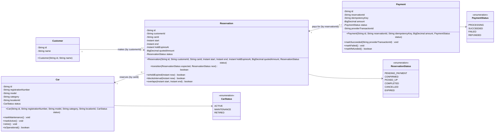
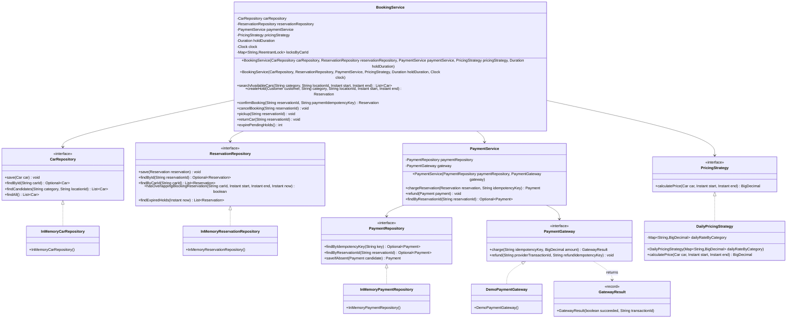
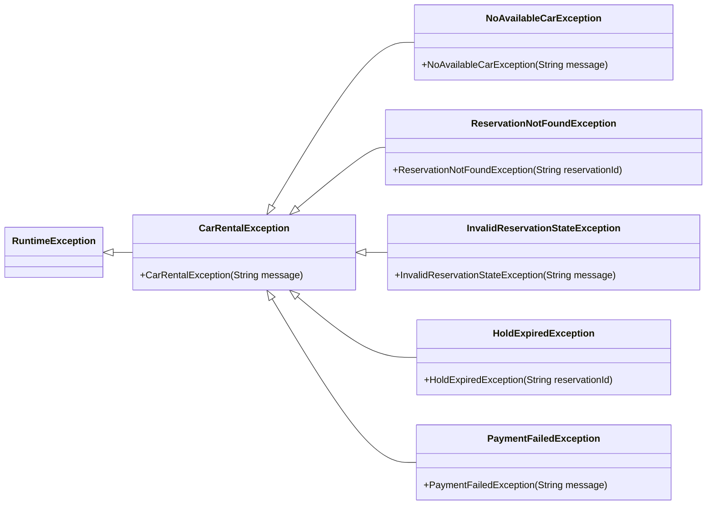
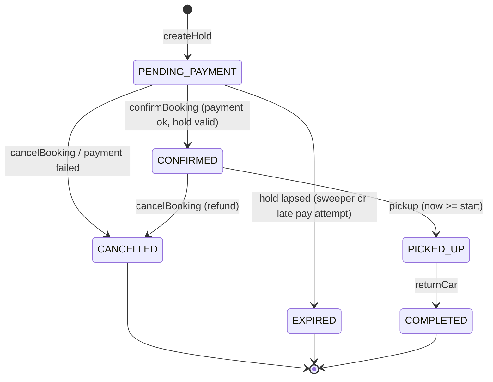
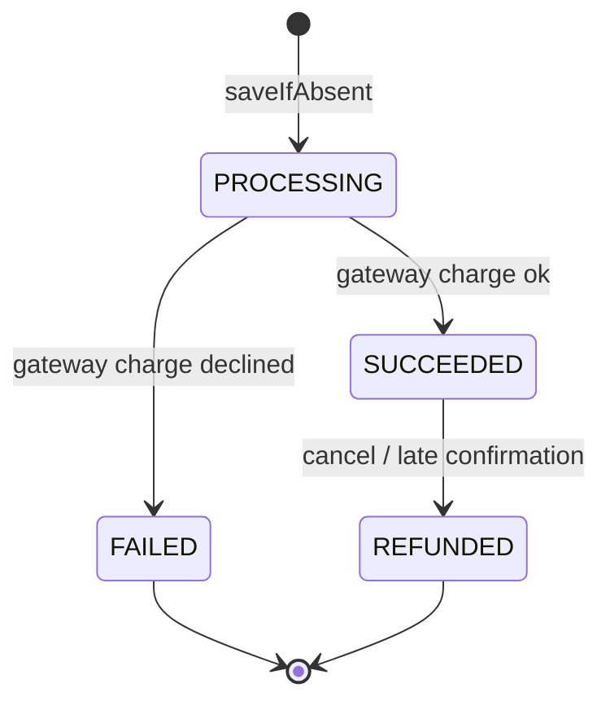
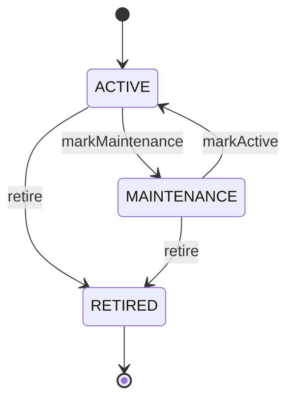
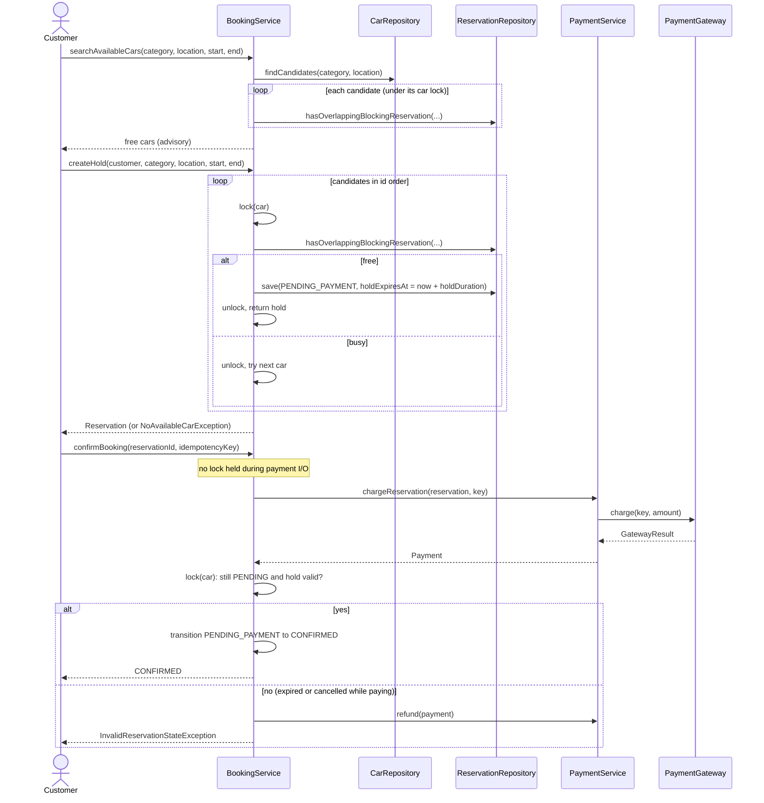
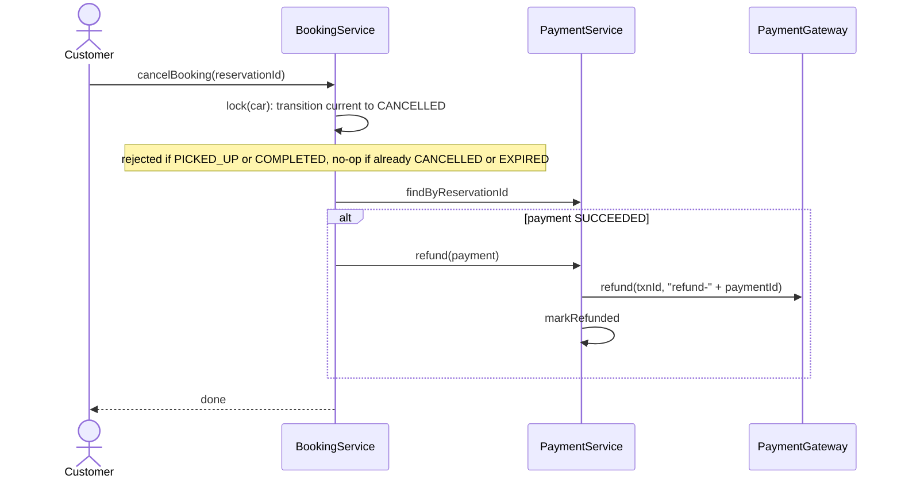

# Low-Level Design — Car Rental System

**Author:** [vinu-varsidh](https://github.com/vinu-varsidh)

LLD reference for the Java car rental in the parent folder. For a from-scratch walkthrough with reasoning, see [Deep Dive](DEEP_DIVE.md).

## Contents

1. [Problem scope](#problem-scope)
2. [Class diagram — domain model](#class-diagram--domain-model)
3. [Class diagram — services, repositories, strategies](#class-diagram--services-repositories-strategies)
4. [Constructor reference](#constructor-reference)
5. [State machines](#state-machines)
6. [Sequence diagrams](#sequence-diagrams)
7. [Availability rule](#availability-rule)
8. [Concurrency model](#concurrency-model)
9. [Pricing](#pricing)
10. [Extension points](#extension-points)
11. [Verification](#verification)

## Problem scope

A customer searches for cars by **category** and **location** for a time window, places a **time-limited hold** on one, **pays**, and the reservation becomes **confirmed**. They can cancel (refund if paid), pick up and return.

In scope: availability without double-booking, hold/expiry, idempotent payments with refund, pluggable pricing, car fleet status.

Out of scope: real payment provider, persistence, auth, late fees, damage/deposit handling, multi-location transfers.

## Class diagram — domain model

Every class shows its **constructor arguments**. Fields marked `-` are private; all domain objects validate their arguments in the constructor and fail fast with `IllegalArgumentException`.



> Relationships are **by id, not by object reference**. A `Reservation` stores `customerId` / `carId`, not `Customer` / `Car`. This keeps aggregates independent and maps directly to foreign keys.

## Class diagram — services, repositories, strategies



### Exceptions



Bad *input* (null, blank, `start >= end`, start in the past, duplicate ids, idempotency-key misuse) throws `IllegalArgumentException`. Bad *business state* throws a `CarRentalException` subtype.

## Constructor reference

| Class | Constructor arguments | Validation |
|---|---|---|
| `Customer` | `String id, String name` | both non-blank |
| `Car` | `String id, String registrationNumber, String model, String category, String locationId, CarStatus status` | strings non-blank, status non-null |
| `Reservation` | `String id, String customerId, String carId, Instant start, Instant end, Instant holdExpiresAt, BigDecimal quotedAmount, ReservationStatus status` | ids non-blank, `start < end`, amount ≥ 0 |
| `Payment` | `String id, String reservationId, String idempotencyKey, BigDecimal amount, PaymentStatus status` | ids/key non-blank, amount non-null |
| `BookingService` | `CarRepository, ReservationRepository, PaymentService, PricingStrategy, Duration holdDuration [, Clock clock]` | all non-null, hold duration > 0; clock defaults to `Clock.systemUTC()` |
| `PaymentService` | `PaymentRepository, PaymentGateway` | non-null |
| `DailyPricingStrategy` | `Map<String, BigDecimal> dailyRateByCategory` | defensively copied (`Map.copyOf`) |
| `GatewayResult` | `boolean succeeded, String transactionId` | none (record) |
| `InMemory*Repository`, `DemoPaymentGateway` | *(none)* | — |

## State machines

### Reservation



| Status | Blocks the car's calendar? |
|---|---|
| `PENDING_PAYMENT` | **Yes, while `holdExpiresAt` is in the future** |
| `CONFIRMED`, `PICKED_UP` | Yes |
| `COMPLETED`, `CANCELLED`, `EXPIRED` | No |

All transitions go through `Reservation.transition(expected, next)`, a compare-and-set: it succeeds only if the status is still what the caller observed.

### Payment



### Car



`CarStatus` is **fleet** status. Whether a car is *booked* is never stored on `Car`; it is derived from the reservations.

## Sequence diagrams

### Search → hold → pay → confirm



### Cancel



## Availability rule

Rentals are **half-open intervals `[start, end)`**. Two rentals overlap iff

```
a.start < b.end  AND  b.start < a.end
```

so a car returned at 10:00 can be picked up by the next customer at 10:00.

A car is available for a requested window iff it is `ACTIVE` and has **no reservation** that both *blocks* (see the [table](#reservation)) and *overlaps* the window.

Because an expired hold simply stops blocking, **no background job is required for correctness**. `expirePendingHolds()` only tidies statuses.

## Concurrency model

| Concern | Mechanism |
|---|---|
| Two customers race for the same car/window | Per-car `ReentrantLock` makes *check overlap + save hold* atomic |
| Stale search results | Search is advisory; `createHold` re-checks under the lock |
| Status transitions racing (pay vs cancel vs expiry) | `Reservation.transition` is a synchronized compare-and-set, executed under the car lock |
| External payment call latency | Charge runs **outside** any lock; the result is reconciled under the lock afterwards |
| Payment succeeded but hold lapsed / cancelled mid-flight | Compensating **refund** |
| Retried / duplicate pay requests | Idempotency key on `Payment`; `saveIfAbsent` is atomic; repeat confirm returns the already-confirmed reservation |
| Double refund | Refund key derived from payment id; `markRefunded` is idempotent |
| Payment indexes diverging | `InMemoryPaymentRepository` updates both maps under one monitor |

**Lock order:** car lock → reservation monitor / payment monitor. Nothing acquires a car lock while holding a monitor, so there is no cycle.

**Limitation:** the locks are in-JVM. Multiple app instances need a database-level guarantee (see [Extension points](#extension-points)).

## Pricing

`DailyPricingStrategy` bills **each started 24-hour block**, minimum one day, `HALF_UP` to 2 decimals.

| Rental length | Billed days |
|---|---|
| 1 hour | 1 |
| 24 hours | 1 |
| 25 hours | 2 |
| 48 hours | 2 |

The price is **quoted once at hold time** and stored on the reservation (`quotedAmount`), so later rate changes never alter an existing booking and the amount charged always equals the amount shown.

## Extension points

| Need | Where |
|---|---|
| Hourly / weekend / surge / tax pricing | New `PricingStrategy` |
| Real PSP (Stripe, Razorpay) | New `PaymentGateway`; must honor idempotency keys |
| Database persistence | New `*Repository` implementations; replace the car lock with a DB constraint |
| Multi-instance safety | Postgres: `EXCLUDE USING gist (car_id WITH =, tstzrange(start_ts, end_ts) WITH &&) WHERE (status IN (...))` |
| Hold sweeper | `ScheduledExecutorService` calling `expirePendingHolds()` |
| Notifications | Domain events published on each transition |
| Cancellation policy | Fee/refund calculator consulted in `cancelBooking` |

## Verification

`CarRentalVerification` runs 88 checks, including a 32-thread race for one car and a 16-thread duplicate-confirm race. Time-dependent behavior (hold expiry, pickup time) uses an injected `MutableClock`, so nothing sleeps. See the [README](../README.md#run-the-verification) for how to run.
